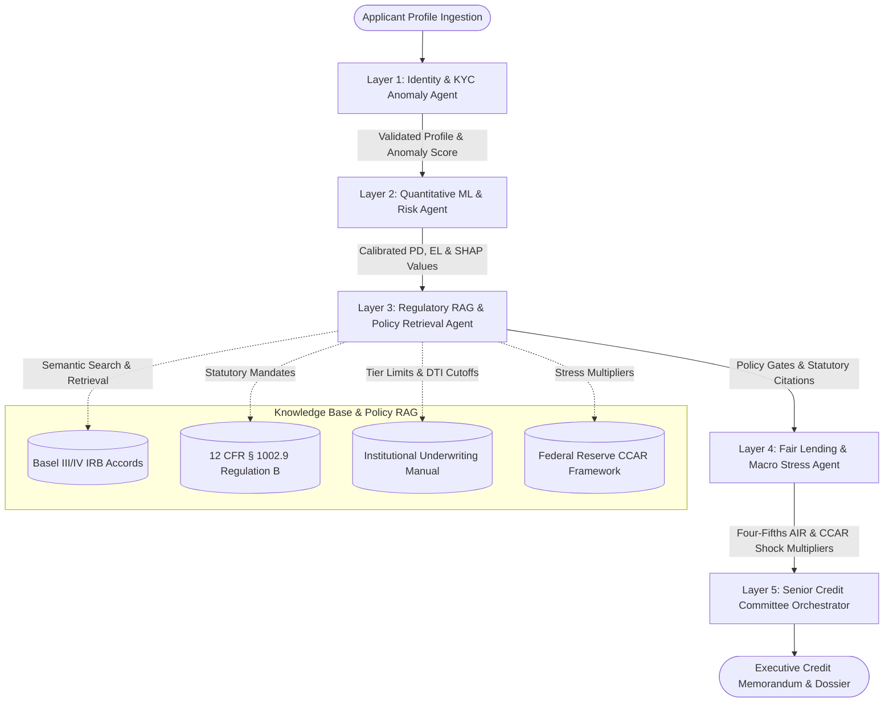

# 🏦 FinRisk AI: Multi-Agent Credit Risk & Financial Intelligence Suite

[](https://www.python.org/downloads/)
[](https://github.com/langchain-ai/langgraph)
[](https://lightgbm.readthedocs.io/)
[](https://www.consumerfinance.gov/)
[](LICENSE)

> **An End-to-End Enterprise Underwriting System featuring 5 Collaborative Multi-Agent Working Layers, LangGraph State Orchestration, Regulatory RAG, Basel III/IV Expected Loss Quantification, and CCAR Macroeconomic Stress Testing.**

---

## 📌 Executive Summary

Modern institutional credit underwriting cannot rely on black-box ML models alone. Global banking regulations (**Basel III/IV IRB Accords**, **ECOA Regulation B - 12 CFR § 1002.9**, and **FCRA § 615**) mandate continuous policy reconciliation, auditable explainability (SHAP), disparate impact fairness checks, and macro shock resilience.

**FinRisk AI** re-architects loan evaluation by replacing monolithic scoring scripts with a **collaborative 5-layer autonomous agent committee**. Each agent layer specializes in a discrete pillar of credit risk analysis, collaborating through a typed **LangGraph StateGraph** to produce auditable, executive-grade Credit Memorandums.

---

## 🏛️ Multi-Agent Working Layers Architecture



### The 5 Autonomous Agent Layers
1. **Layer 1: KYC, Identity & Data Anomaly Agent (`kyc_fraud_agent`)**
   - Audits borrower data for consistency, anomalous debt spikes, unverified income ratios, and synthetic identity indicators.
2. **Layer 2: Quantitative ML Risk Modeling Agent (`quantitative_risk_agent`)**
   - Executes the LightGBM default prediction model, produces calibrated Probability of Default ($PD$), computes Basel Expected Loss ($EL = PD \times EAD \times LGD$), and maps borrower ratings to institutional credit tiers (AAA through Subprime).
3. **Layer 3: Regulatory RAG & Policy Retrieval Agent (`policy_rag_agent`)**
   - Interrogates the banking knowledge base using a lexical & semantic RAG retriever. Fetches exact legal citations for adverse action disclosures (12 CFR § 1002.9) and checks hard underwriting gates (DTI ceilings, minimum credit scores).
4. **Layer 4: Fair Lending Auditor & Stress Testing Agent (`fairness_stress_agent`)**
   - Audits Disparate Impact across cohorts using the **Four-Fifths (80%) Rule** ($AIR \ge 0.80$). Simulates CCAR Severely Adverse macroeconomic shocks (+300 bps interest rate spike, 10% peak unemployment).
5. **Layer 5: Senior Credit Committee Orchestrator (`credit_committee_agent`)**
   - Synthesizes findings from all prior layers, establishes Risk-Adjusted Return on Capital (RAROC) APR pricing, constructs actionable counterfactual advice, and drafts a comprehensive Credit Memorandum.

---

## ⚡ Key Technical Innovations

- **LangGraph StateGraph Workflow**: Type-safe, auditable state passing across agent nodes with full JSON audit logging.
- **Explainable AI (XAI)**: SHAP-driven local feature attribution identifying both positive risk-mitigating and negative risk-escalating drivers.
- **Statutory Adverse Action Reason Codes**: Automatically extracts the top 4 principal reasons for loan denial, strictly complying with Equal Credit Opportunity Act mandates.
- **Prescriptive Counterfactual Engine**: Computes exact numeric milestones (e.g., debt paydown amount, loan principal reduction, or co-signer addition) required to flip adverse decisions.
- **Macro Stress Resilience**: Simulates multi-scenario macroeconomic shocks to prevent procyclical lending defaults.

---

## 🚀 Quickstart Guide

### 1. Set Up Virtual Environment & Dependencies

```bash
# Clone the repository
git clone https://github.com/niraj987/Credit-Risk-Modeling.git
cd Credit-Risk-Modeling

# Create & activate virtual environment
python -m venv .venv
# On Windows:
.\.venv\Scripts\activate
# On Linux/macOS:
source .venv/bin/activate

# Install dependencies
pip install -r requirements.txt
```

### 2. Launch the Interactive Dashboard

```bash
streamlit run app.py
```
Navigate to `http://localhost:8501` to test interactive borrower presets, inspect agent telemetry, and view real-time RAG retrievals.

### 3. Run via Command Line Interface (CLI)

```bash
# Run multi-agent underwriting on an applicant profile
python -m credit_agents.cli run --score 710 --income 85000 --loan 20000 --dti 0.28

# Search the regulatory RAG policy knowledge base
python -m credit_agents.cli rag "What are the adverse action notice requirements under ECOA?"

# Train or retrain the LightGBM credit default model
python -m credit_agents.cli train
```

### 4. Run the Test Suite

```bash
pytest tests/ -v
```

---

## 📊 Mathematical Foundations

### Basel Expected Loss ($EL$)
$$\text{Expected Loss (EL)} = \text{PD} \times \text{EAD} \times \text{LGD}$$
- **PD**: 1-year default probability predicted by calibrated LightGBM.
- **EAD**: Exposure at Default (total loan balance).
- **LGD**: Loss Given Default (Supervisory benchmark of 45.0% for senior unsecured debt).

### Fair Lending Adverse Impact Ratio ($AIR$)
$$\text{Adverse Impact Ratio (AIR)} = \frac{\text{Approval Rate}_{\text{Protected Cohort}}}{\text{Approval Rate}_{\text{Reference Cohort}}} \ge 0.80$$

---

## 🎯 Enterprise Highlights for Technical Evaluation

- **End-to-End Orchestration**: Deploys a stateful **LangGraph** multi-agent graph with checkpointing, ensuring auditability and state immutability.
- **Explainable AI (XAI)**: Regulatory-compliant SHAP force attribution mapped directly to ECOA Adverse Action Reason Codes.
- **Regulatory RAG**: Dynamic retrieval over Basel III/IV IRB accords, 12 CFR § 1002.9, and institutional credit policy handbooks.
- **Fair Lending Governance**: Built-in Four-Fifths Adverse Impact Ratio auditing and CCAR macroeconomic stress testing (+300 bps shock).

---

## 📄 License
This project is licensed under the MIT License - see the [LICENSE](LICENSE) file for details.
